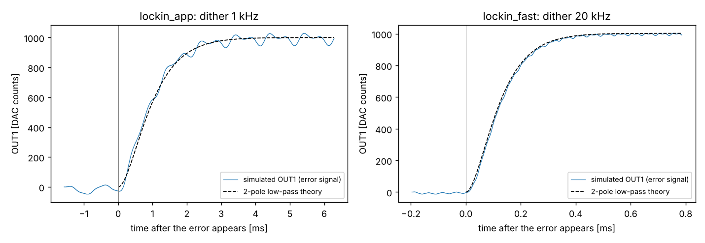

# Cavity lock: speed, latency and noise study

Oct 29, 2026 · Nathan Song · exported from the claude.ai doc "Cavity lock: speed, latency and noise study" (https://claude.ai/artifact/HjMYekzFVDwpCB3jPw6qkP)

## Summary

The lock is slow because of its settings, not the Red Pitaya. Its FPGA path takes about 0.2 µs. The lock-in low-pass that a 1 kHz dither needs takes about 0.8 ms. That low-pass caps the loop at about 100 Hz, and it currently runs at 10 Hz.

The Red Pitaya's electronics add no meaningful noise. The intensity noise after locking is most likely two things. One is vibration above the 10 Hz bandwidth. The other is the dither itself, which modulates the transmission at twice its frequency: 34 % peak-to-peak at the steepest-slope dither, and nearly 100 % at the 30 mVpp default if your linewidth is about 6 mV of OUT1.

The app now redraws up to 10 times per second. It also has two tools, *Measure noise* and *Measure loop*, to tell which noise source dominates. The plan: measure, shrink the lock dither, then raise the dither frequency.

## 1. Loop speed: where the delay is

The Red Pitaya takes about 0.2 µs from IN1 to OUT1. The lock is slow for other reasons: the 10 Hz default loop bandwidth, the two 304 Hz low-pass stages that remove the 1 kHz dither from the error signal, and the PZT driver and PZT. The Python app is never inside the loop, so making it faster changes the display, not the lock.

| Stage, IN1 to OUT1 | Delay | Source |
| --- | --- | --- |
| ADC pipeline (LTC2145-14) | 48 ns (6 clocks) | [LTC2145-14 datasheet](https://www.analog.com/media/jp/technical-documentation/data-sheets/j21454314fa.pdf) |
| FPGA input register | 8 ns | `red_pitaya_top.v` |
| IQ demodulator → PID → output adder (filters off) | 96 ns (12 clocks) | Verilog simulation, section 2 |
| FPGA output register and DDR stage | 16 ns | `red_pitaya_top.v` |
| DAC latch, settling, analog filters | about 43 ns | [AD9767 datasheet](https://manualmachine.com/analogdevices/ad9767/3998985-datasheet) (35 ns settling) |
| **Total, analog in to analog out** | **about 211 ns** | published Red Pitaya loops: 200 ns ([Preuschoff et al.](https://arxiv.org/pdf/2009.00343)) |
| Lock-in low-pass, 2 × 304 Hz: time to 50 % | **810 µs** | Verilog simulation, section 2 |

The low-pass is about 4000 times slower than everything else combined. It has to stay below the dither frequency, so **the dither frequency sets the speed limit**. At a 135° total phase lag (45° margin), a 1 kHz dither allows about 100 Hz of loop bandwidth. A 20 kHz dither with 2 × 2.4 kHz low-pass allows about 400 Hz with a 1 kHz PZT driver, and more with a faster one.

*(Chart in the original doc: total loop phase lag vs frequency for the app defaults and the 20 kHz "fast" setup, PZT driver taken as a 1 kHz pole. The numbers are in `fpga/redpitaya_latency_sim/example_output/sim_results.json`, keys `phase_budget_app` / `phase_budget_fast`: [f Hz, FPGA+converter delay lag deg, lock-in LPF lag deg, driver lag deg, total lag deg including the integrator 90°].)*

Where each line crosses 135° is the highest loop bandwidth with a 45° margin. A faster PZT driver moves both crossings right.

**What changed in the app** (`cavity_lock_app.py`):

- **Browser drawing.** The server now sends compact data and the browser draws the plots. The server's cost per refresh fell from about 170 ms to about 4 ms. A *Browser refresh* setting defaults to 10 Hz. In tests the display redrew 7 times per second while acquiring, which is every trace a 20 Hz ramp delivers, and 10 times per second when locked, where traces arrive about 20 times per second. The live plots use SVG, because WebGL refreshed about half as fast in testing.
- **Fewer network round trips per scope capture.** Scope settings are written only when they change, the app waits one trace length before polling, and the time axis is computed locally. Register accesses per locked trace fell from 24 to 5. The live trace defaults to 33 ms instead of 130 ms.
- **Loop model.** A predicted bandwidth and phase margin from the low-pass, a new *PZT driver bandwidth* setting and the 0.2 µs delay. The app warns below 45°.
- **Measure noise** (while locked). Spectra of the residual detuning, from the error signal, and of the transmitted intensity, 0.5 Hz to about 1 MHz, with rms per band. Dotted lines mark the dither harmonics.
- **Measure loop** (while locked). PyRPL's network analyzer puts a small sine on OUT1 and reads both the PID output and the error signal. That gives the open-loop gain, the unity-gain frequency, the phase margin and the PZT response, so you can see how far the bandwidth can go.

## 2. FPGA latency simulation

PyRPL's FPGA code is written in **Verilog**, not VHDL. The `redpitaya_latency_sim` package runs PyRPL's own `red_pitaya_dsp` module in Icarus Verilog, a free simulator. It uses PyRPL 0.9.9.1, the same code as the bitstream your PyRPL uploads. Nothing is re-implemented. Inside the FPGA logic the lock-in path takes **12 clocks (96 ns)**, while the error signal's low-pass takes **0.81 ms** to reach 50 %.

| Experiment | Path | Result |
| --- | --- | --- |
| `pid_p` | IN1 → PID0 (P = 1, no filters) → OUT1 | 9 clocks = 72 ns |
| `iq_unfiltered` | IN1 → IQ0 (filters off) → PID0 → OUT1 | 12 clocks = 96 ns |
| plus converters and I/O | ADC 6 clocks, I/O registers 2, DDR stage 1, DAC latch 1, settling about 4.4 | 187 ns (PID path), 211 ns (lock-in path) |
| `lockin_app` | app defaults: 1 kHz dither, 76 Hz high-pass, 2 × 304 Hz low-pass | 50 % after 0.81 ms, 90 % after 1.9 ms |
| `lockin_fast` | 20 kHz dither, 2 × 2.4 kHz low-pass | 50 % after 0.11 ms, 90 % after 0.25 ms |

In the Verilog, the 12 clocks break down as 3 in the demodulator (input register, multiply, output scaling), 4 in the PID (error, gain, sum, clamp) and 5 in the tree that sums every module's output into OUT1. Each low-pass stage adds 2 clocks on top of its time constant, and the high-pass adds 1.

**To run it on Windows:**

1. Install Icarus Verilog from [bleyer.org/icarus](https://bleyer.org/icarus/). During setup, tick *Add executable folder(s) to the user PATH*. The installer also includes GTKWave for viewing waveforms.
2. In the unzipped folder, run `python fetch_rtl.py`. It downloads PyRPL's Verilog from [GitHub](https://github.com/pyrpl-fpga/pyrpl) (tag 0.9.9.1) and writes a simulation copy.
3. Run `python run_sim.py`. It takes about 2 minutes, or less with `--fast`, which skips the lock-in runs. Use `--settings ..\cavity_lock_settings.json` to simulate your saved settings, `--driver-bw 1000` to set your PZT driver's bandwidth, and `--vcd` to save waveforms for GTKWave.

The simulation copy has three start-up values and one table index edited so the simulator behaves like the synthesized chip. The IIR module, which the lock does not use, is replaced by a stub. The README lists each edit.

These numbers come from my earlier attempt in this session, before you rewound. This time the workspace blocked running downloaded code, so I couldn't re-run it. The 9- and 12-clock results match a count by hand from the Verilog.

## 3. Component-by-component noise

Every block inside the Red Pitaya adds at most 10⁻⁴ of the linewidth of detuning noise over 1 kHz, so none of them explains the intensity noise you see. The one block that can matter is the DAC's step size, when the linewidth spans only a few millivolts of OUT1. The detuning figures below assume the 40 MHz linewidth spans 5 mV of OUT1 and the transmission peak is 0.65 V. After *Auto-optimize phase*, the app prints your own linewidth in mV.

| Block | Red Pitaya (what you have) | Commercial reference | Effect on your lock |
| --- | --- | --- | --- |
| Input stage + ADC | LTC2145-14: 1.25 LSB rms transition noise (19 nV/√Hz), 73 dBFS SNR ([datasheet](https://www.analog.com/media/jp/technical-documentation/data-sheets/j21454314fa.pdf)); board spec under 0.5 mV rms full band, about 63 nV/√Hz ([Red Pitaya](https://redpitaya.readthedocs.io/en/latest/developerGuide/hardware/ORIG_GEN/measurements/STEMlab-125-14/fast_analog_inputs.html)) | [SR560](https://thinksrs.com/products/sr560.html) preamp 4 nV/√Hz; [SR810](https://xdevs.com/doc/Stanford_Research_Systems/www.thinksrs.com-SR810m.pdf) input 6 nV/√Hz; [ZFL-500LN+](https://www.eg.bucknell.edu/~dkelley/eceg497/lab/Datasheet_ZFL-500LNplus.pdf) RF amp NF 2.9 dB, 0.1–500 MHz only | 1–4 Hz/√Hz of detuning through the error signal; about 10⁻⁶ of the linewidth over 1 kHz |
| Mixer | Digital: 13-bit phase into the sine table, so spurs near −78 dBc; exact 90° quadrature; no DC offset | [ZAD-1+](https://www.minicircuits.com/pdfs/ZAD-1+.pdf): 5.2 dB conversion loss, 45 dB LO–RF isolation, LO and RF 0.5–500 MHz (not usable at kHz); [AD633](https://www.komponenten.es.aau.dk/fileadmin/komponenten/Data_Sheet/Linear/AD633.pdf) multiplier: 0.8 µV/√Hz, ±1–2 % error | No added noise, and no offset that drifts the lock point (analog mixers have both) |
| Low-pass | 1st-order digital stages, 24-bit; iq0 has 2 stages; corners in factor-2 steps | SR810: 6–24 dB/oct, 10 µs to 30 ks | No added noise; the limit is the 12 dB/oct slope, which sets how much 2f ripple gets through |
| Gain | Integer quadrature factor | SR560: 1 to 50,000 | Exact, no noise |
| PI servo | pid0: 24-bit gains, 48-bit integrator, 0.2 µs total delay | [LB1005](https://api.p1.mks.com/medias/sys_master/images/images/he7/h11/8797219487774/New-Focus-LB1005-Datasheet.pdf): over 10 MHz bandwidth, under 10 nV/√Hz | No drift; the delay costs 0.08° at 1 kHz and 7.6° at 100 kHz |
| DAC + output | AD9767, 14-bit: 125 µV rms over 50 MHz, about 18 nV/√Hz ([Preuschoff et al.](https://arxiv.org/pdf/2009.00343)); one step = 122 µV | Analog servo outputs have no steps | Noise: about 140 Hz/√Hz, 10⁻⁴ of the linewidth over 1 kHz. **One step = 2.4 % of a 5 mV linewidth** |
| PZT driver (yours) | Model not known | Low-noise design: 260 µV rms over 0.1 Hz–100 kHz ([Doret](https://arxiv.org/pdf/1712.06627)); commercial specs often come from a meter reading, which understates | Divide its rms noise by the linewidth in volts at the PZT |
| Laser intensity noise | Outside the Red Pitaya | — | Goes straight into the transmission; no lock can remove it |

**What does limit the lock** is the loop bandwidth, plus the dither itself. A 10 Hz bandwidth leaves acoustic vibration above 10 Hz almost uncorrected. The dither modulates the transmitted power at twice its frequency, as the table shows. With a 30 mVpp lock dither on a 5–6 mV linewidth (about 5 linewidths), the mean transmission drops to about 20 % and the 2f modulation is nearly 100 %.

| Lock dither, peak-to-peak | Mean transmission | Transmission ripple at 2f | Error slope (vs. optimum) |
| --- | --- | --- | --- |
| 0.1 linewidth | 99.5 % | 1 % | 26 % |
| 0.3 linewidth | 96 % | 8 % | 68 % |
| 0.71 linewidth (steepest slope) | 82 % | 34 % | 100 % |
| 1 linewidth | 71 % | 50 % | 92 % |

**The circuit change worth making:** if your linewidth spans less than about 20 mV of OUT1, put a 10:1 resistive divider between OUT1 and the driver's MOD IN. It shrinks the DAC step and the DAC noise 10× relative to the linewidth. The cost is scan range: ±0.1 V at MOD IN, so use the driver's DC knob for coarse tuning.

## Next measurements and settings

Measure first, then raise the dither frequency a step at a time. The app's two new tools show when to stop.

1. **Find the noise.** Lock and press *Measure noise*. A peak at twice the dither frequency is the dither itself. A band of peaks between about 10 Hz and 1 kHz is vibration the loop is too slow to correct. A flat floor is likely laser intensity noise; check it by measuring the laser before the cavity with the same photodiode.
2. **Use the bandwidth you already have.** Press *Measure loop*, then raise *Loop bandwidth* until the measured phase margin falls to about 45°. With the 1 kHz dither, expect about 100 Hz.
3. **Shrink the lock dither.** Untick *Lock dither = acquisition dither* and set it to 0.2–0.3 linewidths. The 2f ripple drops from 34 % to 4–8 %, and 50–70 % of the slope remains. Raise the error gain to make up the difference.
4. **Raise the lock dither frequency** in steps: 2, 5, 10, 20 kHz. At each step, check that the measured dither amplitude on OUT1 holds and that LOCK! still fits a clean phase. Set the low-pass near dither/8; the loop bandwidth can then reach about dither/20, less with a slow driver. Stop when *Measure loop* shows a PZT resonance or the margin won't reach 45°.
5. **Add the 10:1 divider** from section 3 if your linewidth spans less than about 20 mV of OUT1.
6. **Re-run the latency simulation** with `--settings` to check the lock-in delay of the setup you settle on.
7. **Longer term:** a PZT dither tops out around the PZT's first resonance. For kilohertz-to-megahertz bandwidth, the modulation has to leave the PZT. Options are an EOM sideband (Pound–Drever–Hall) lock or a modulation-free method such as tilt locking.

## Sources

- [PyRPL FPGA source, tag 0.9.9.1](https://github.com/pyrpl-fpga/pyrpl)
- [LTC2145-14 datasheet](https://www.analog.com/media/jp/technical-documentation/data-sheets/j21454314fa.pdf)
- [AD9767 datasheet](https://manualmachine.com/analogdevices/ad9767/3998985-datasheet)
- [Red Pitaya STEMlab 125-14 fast analog inputs](https://redpitaya.readthedocs.io/en/latest/developerGuide/hardware/ORIG_GEN/measurements/STEMlab-125-14/fast_analog_inputs.html)
- [Preuschoff et al., digital laser stabilization on the STEMlab](https://arxiv.org/pdf/2009.00343)
- [SR810 manual](https://xdevs.com/doc/Stanford_Research_Systems/www.thinksrs.com-SR810m.pdf)
- [SR560 specifications](https://thinksrs.com/products/sr560.html)
- [New Focus LB1005 datasheet](https://api.p1.mks.com/medias/sys_master/images/images/he7/h11/8797219487774/New-Focus-LB1005-Datasheet.pdf)
- [AD633 datasheet](https://www.komponenten.es.aau.dk/fileadmin/komponenten/Data_Sheet/Linear/AD633.pdf)
- [Mini-Circuits ZAD-1+](https://www.minicircuits.com/pdfs/ZAD-1+.pdf)
- [Mini-Circuits ZFL-500LN+](https://www.eg.bucknell.edu/~dkelley/eceg497/lab/Datasheet_ZFL-500LNplus.pdf)
- [Doret, low-noise piezo driver](https://arxiv.org/pdf/1712.06627)
- [Icarus Verilog for Windows](https://bleyer.org/icarus/)
